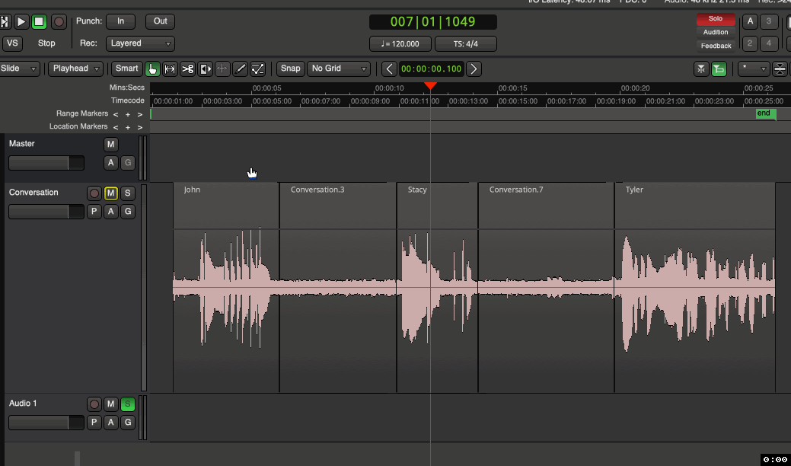

# Audio Region Exporter
 
"Audio Region Exporter" _(Audio_Region_Exporter.lua)_ is a Lua script for Ardour 9.10+ (and Harrison Mixbus) that will batch-export selected audio regions.

.png)

### Features

- Works with audio regions of all kinds.
- Exports each selected region to its own, single file, one after the next.
- Select from any of the available export preset options.
- Select the location to export the files to.
- Can select regions across _multiple tracks._
- Automatically solos the appropriate track for each region during export (-although this can be disabled if desired).
- Restores original project solo state after exporting in complete.
- Automatically prevents file erasure by checking for existing file-names in the destination.
- Reports export data in a final popup window.

--------------------------------------------------

### Example Usage:

--------------------------------------------------

### Other Comments

In deciding what Lua binding(s) to use for the core of this script, there were a few possibilities...

- Ardour can _bounce_ regions (with or without processing).  However, this leads to the generation of _multiple mono files_ (in the case of bouncing a region that's stereo, or 3+ channels).  This is fine for _Ardour,_ typically, as these bounced mono files are intended to exist _'under the hood',_ for Ardour's use only.  But for our purposes, where we want _single file_ exports, bouncing is therefore not ideal.
- Then we have various bindings like _export_audio, export_range, export_selection, etc.,_ -all of which seemingly take no arguments and simply open the main, corresponding GUIs for exporting audio.  So, in our case, unless someone wants to deal with a single GUI _per region,_ these are not viable options either.
- Luckily, however, _simple_export_ exists, which allows our script to bypass the main export GUI altogether, and run export operations in sequence, quickly.  Thus, the "ARDOUR.SimpleExport" class is exactly what's best for this script!

As the main GUI for _Audio Region Exporter_ states, this script exports the full line of potential processing from region to → Master bus.  This may include track/bus plugins, fader automation, etc..  If this is not desirable, then for now, please ensure that all plugins and automation are disabled along the chain from the regions you wish to export to the Master bus. (Note that it is likely possible (although probably very complicated) to have this script automatically disable all plugins/automation from region to → Master, export the region, then re-enabled the original plugins/automation.  For now, however, I think that's too much work to implement. :P)

--------------------------------------------------

## Installation

Simply [download the script](https://github.com/GhostsonAcid/Audio_Region_Exporter/blob/main/Audio_Region_Exporter.lua), and then do the following based on your OS:

### GNU/Linux:

1. Navigate to the $HOME/.config/ardour9/scripts folder.
2. Place Audio_Region_Exporter.lua in that scripts folder.
3. _(continues below...)_

### macOS/Mac OS X:

1. Open a Finder window, press cmd-shift-G, and type-in: ~/Library/Preferences/Ardour9/scripts/
2. Place Audio_Region_Exporter.lua in that scripts folder.
3. _(continues below...)_

### Windows:

1. Navigate to the %localappdata%\ardour9\scripts folder.
2. Place Audio_Region_Exporter.lua in that scripts folder.
3. _(continues below...)_

### _Continued steps for all systems:_

3. Open Ardour and go to _Edit → Lua Scripts → Script Manager._
4. Select an "Action" (e.g. "Action 1", etc.) that is "Unset", then click "Add/Set" at the bottom-left.
5. Click "Refresh", and then find and select Audio Region Exporter in the "Shortcut" drop-down menu.
6. Click "Add" and then close the Script Manager window.
7. Audio Region Exporter now exists as an easy-access button in the top-right of the DAW.

> [!TIP]
> You can always just click any empty shortcut button in the top-right, hit "Refresh", and then find and set a Lua script.
> To remove a shortcut from a button, hold shift and then right-click it.

--------------------------------------------------

_~Enjoy!_

_J. K. Lookinland_
